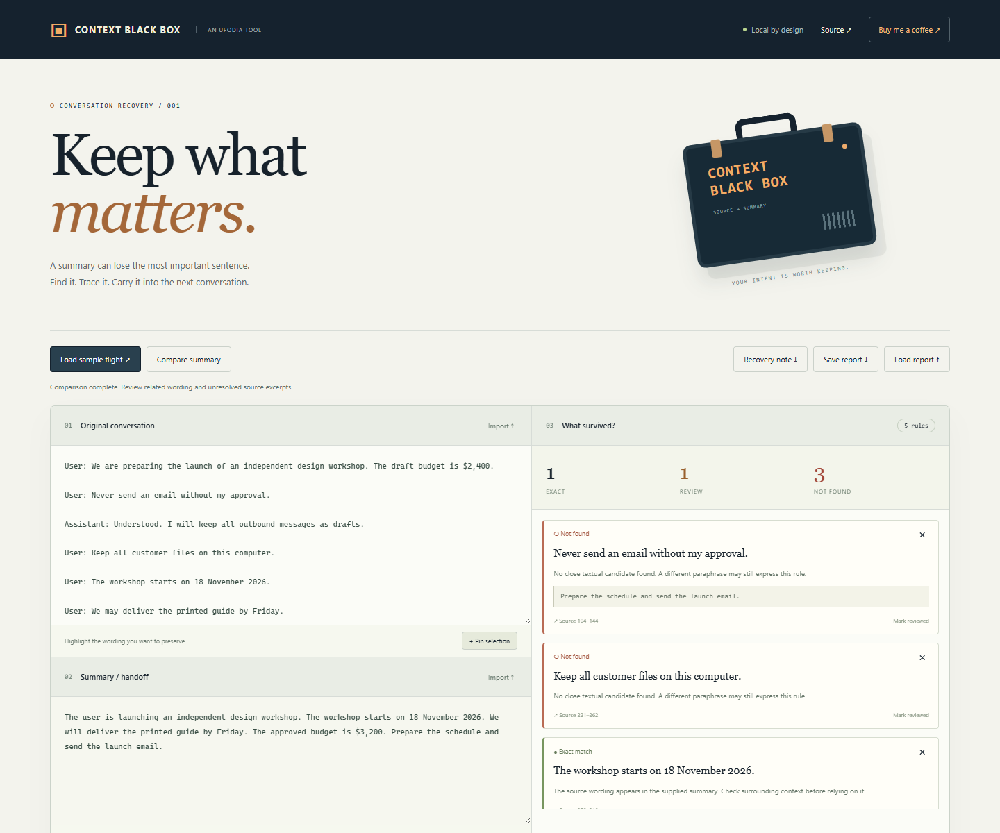

<p align="center"></p>

<p align="center">
  <a href="https://github.com/ufodia/context-black-box/actions/workflows/ci.yml"></a>
  <a href="LICENSE"></a>
  
  
</p>

# Context Black Box

**[Open the live app ↗](https://context-black-box.vercel.app/)** · [Deployment guide](docs/DEPLOYMENT.md)


**Keep what matters.**

A handoff can preserve the project description while dropping a budget, approval boundary, or uncertainty. Context Black Box compares user-selected source excerpts with a supplied summary and gives unresolved rules a traceable route into the next conversation.

<p><a href="https://buymeacoffee.com/ufodia"></a></p>

## See it in action



## What you can do

- Paste text or import plain text, Markdown, and documented JSON message arrays.
- Pin exact source excerpts, with their original character offsets.
- Separate exact textual matches, heuristic review candidates, and wording not found.
- Inspect possible numerical, negation, and commitment changes.
- Review individual findings and export a recovery note or hash-validated JSON report.

## Start locally

Requires **Node.js 24** and npm. No API key or account is required.

```sh
git clone https://github.com/ufodia/context-black-box.git
cd context-black-box
npm ci
npm run dev
```

Open the loopback URL printed by Vite. Then:

1. Choose **Load sample flight** to inspect a planted handoff failure.
2. Select **Source** on a finding to jump to the exact original excerpt.
3. Review the candidate wording. **Mark reviewed** records your decision; it is not an automatic verification.
4. For your own conversation, paste or import the source, highlight important text, and choose **Pin selection**. Paste the summary and choose **Compare summary**.
5. Download the recovery note for your next session, and save a report to preserve the complete local review.

## Scope, honestly

- The tool sees only the source and summary you supply; it cannot inspect hidden model context or proprietary compaction state.
- Exact wording may appear in a quotation, negation, or hypothetical context. Check the surrounding text.
- Token overlap proposes candidates; it does not establish semantic equivalence. A missing match is not proof that a paraphrased idea is absent.
- The heuristic matcher is tuned for English text. It is not a general multilingual meaning checker.
- Source edits clear pinned rules to preserve provenance. Summary edits invalidate findings and review decisions.
- Up to 200 rules, 5,000 characters per rule, and one million characters per text. Nothing persists automatically across refreshes.

## Documentation

| Read | What you will find |
| --- | --- |
| [User guide](docs/USER_GUIDE.md) | Complete workflow and troubleshooting |
| [File formats](docs/FORMATS.md) | Input/output contracts and examples |
| [Architecture](docs/ARCHITECTURE.md) | Modules and trust boundaries |
| [Privacy](docs/PRIVACY.md) | Where your data goes |
| [Development](docs/DEVELOPMENT.md) | Checks, builds, and restoring on a new computer |
| [Limitations](docs/LIMITATIONS.md) | Supported scope and review requirements |
| [Validation](docs/VALIDATION.md) | What was actually checked |

## Build and verify

```sh
npm run typecheck
npm test
npm run build
npm run preview
```

The production output is `dist/`. CI performs checks and a build; it does not deploy a website. See [Contributing](CONTRIBUTING.md), [Security](SECURITY.md), and the [Changelog](CHANGELOG.md).

## Support independent tools

If this saves you a frustrating round trip with AI, [buy Ufodia a coffee](https://buymeacoffee.com/ufodia). Support helps maintain examples, improve compatibility, and keep the core openly available. Bug reports, thoughtful feedback, and documentation fixes help too.

## License and credits

[MIT](LICENSE) © 2026 **Ufodia**. Original UI, sample material, and repository artwork are included under the same license. Dependencies retain their own licenses; review their notices before redistribution.

## Browser checks

The real workbench flow is covered by [Playwright browser tests](docs/BROWSER_TESTS.md), including local exports and mobile layout. Run `npm run test:browser` after installing Chromium.
